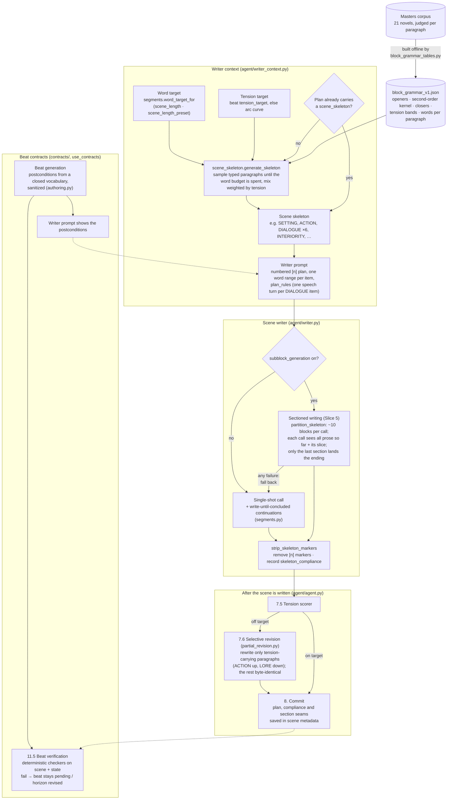

# The Block DSL in the Writer Path

**Status:** Describes shipped code as of 2026-10-31. Every switch below is **default off**.
**Design history:** `CONTRACTS_AND_BLOCKS_ARCHITECTURE.md` (the 2025-11 design proposal) and `BLOCKS_CONTRACTS_LANDING_SKETCH.md` (the slice plan). The evidence is in `MASTERS_BLOCK_GRAMMAR_STUDY.md` and `SLICE4_SCENE_SKELETON_RESULTS.md`.

The block DSL comes down to one idea. Python decides the *shape* of a scene as an ordered list of typed paragraphs (a "scene skeleton"), and the writer LLM fills each slot with prose. The block types are SETTING, CHARACTER_DESC, LORE, DIALOGUE, ACTION, INTERIORITY and TRANSITION. The shape is sampled from a grammar measured on 21 classic novels. The plan then follows the scene through writing, stripping, revision and commit.

Contracts are the other half of the DSL. They work at the beat level, not the paragraph level, and they are shown on the right-hand side of the diagram.

## Diagram

## Walkthrough

1. **The grammar is built offline.** `scripts/block_grammar_tables.py --json` turns the judged corpus into `novel_agent/data/block_grammar_v1.json`. It holds what tends to open and close a scene, which block tends to follow which, how the mix shifts with tension, and how long each kind of paragraph runs (DIALOGUE about 22 words median, LORE about 85).
2. **A skeleton is sampled per scene** (`generation.enable_scene_skeleton`). `WriterContextBuilder._build_scene_skeleton` takes the scene's word target and tension target. The tension target is the beat's `tension_target` when it is fresh, otherwise the arc curve's value for this tick. `generate_skeleton` samples typed paragraphs until the word budget is spent, so a dialogue scene gets many short items and an exposition scene a few long ones. If the plan already carries a `scene_skeleton`, it wins over the sampled one. No planner prompt asks for one today, so in practice every skeleton is sampled.
3. **The plan rides the writer prompt** as numbered `[n]` items, each with its mode, a gloss and its own word range. `plan_rules()` adds the shared rules: one paragraph per item, and each consecutive DIALOGUE item is one speech turn.
4. **The scene is written** in one of two ways:
   - **Single-shot** (default): one call, plus bounded continuations from the write-until-concluded loop if it stops early.
   - **Sectioned** (`generation.subblock_generation`, needs a skeleton): the plan is cut into contiguous ranges of `subblock_section_blocks` items, and each range is written by its own call. An empty section is retried once. Any other failure falls back to single-shot, so the flag can never cost a scene.
5. **Markers are stripped and compliance is recorded.** A scene is compliant when every plan item was written and nothing extra was written. A failure here is logged and the scene ships anyway.
6. **Tension correction respects the plan.** If the scored tension is off target, step 7.6 rewrites only the paragraphs whose mode carries tension, capped by `coherence.partial_rewrite_max_blocks` and never more than a third of the scene. Everything else is returned byte-identical, so the plan and its compliance survive. This replaced a whole-scene rewrite that cut paragraph counts in half.
7. **The plan is persisted** on the committed scene's metadata (`scene_committer.py`), so a finished scene can be audited block by block.
8. **Contracts run alongside** (`generation.use_contracts`). Beat generation authors postconditions from the closed checker vocabulary, the writer is shown them, and step 11.5 checks them against the written scene and the post-scene state.

## What is switched on

| Piece | Config switch | Default | Evidence |
|---|---|---|---|
| Scene skeletons (Slice 4) | `generation.enable_scene_skeleton` | off | July A/B on gpt-5.5: every well-measured block statistic moved toward the masters, 16/16 marker compliance. The September sizing changes have not been re-validated. |
| Sectioned writing (Slice 5) | `generation.subblock_generation` | off | Built and run live. The quality A/B (seams, voice, cost) is still owed. |
| Selective tension revision | `coherence.tension_rewrite` (on) | on, but only acts on skeleton scenes | Live 2026-09-13 |
| Beat contracts (Slice 1) | `generation.use_contracts` | off | Smoke-run live 2026-07-10, where a failing contract wedged a beat. No quality A/B. |
| Contract Slices 2–3 (precondition pressure, repair) | — | not built | — |
